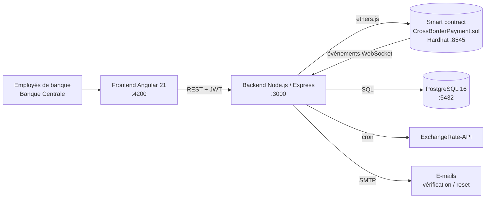

# CrossBorder Payment

**Plateforme hybride blockchain / bancaire pour les virements internationaux entre banques.**

Les transferts sont exécutés par un smart contract Ethereum : conversion de devises, frais, plafond journalier, validation des gros montants et liste noire anti-blanchiment. Un back-end Node.js synchronise la blockchain avec PostgreSQL, et une application Angular permet aux employés de banque et à la Banque Centrale de piloter l'ensemble.

> Projet de fin d'études (PFE) d'ingénieur en Génie Informatique à l'ESPRIT, réalisé à l'**UBCI (groupe BNP Paribas)** entre février et juillet 2026.


---

## Sommaire

- [Contexte](#contexte)
- [Fonctionnalités](#fonctionnalités)
- [Architecture](#architecture)
- [Règles du smart contract](#règles-du-smart-contract)
- [Stack technique](#stack-technique)
- [Démarrage rapide (Docker)](#démarrage-rapide-docker)
- [Installation sans Docker](#installation-sans-docker)
- [Tests](#tests)
- [API REST](#api-rest)
- [Structure du projet](#structure-du-projet)
- [Auteur](#auteur)

---

## Contexte

Aujourd'hui, un virement international passe par plusieurs banques intermédiaires. Il met plusieurs jours à arriver, chaque étape prend des frais et son suivi est opaque.

CrossBorder Payment propose une alternative : les banques partenaires sont enregistrées sur une blockchain commune, et chaque transfert est **exécuté, converti, tarifé et tracé par un smart contract**. Toutes les opérations sont vérifiables et horodatées. La Banque Centrale garde la main sur les paramètres sensibles : taux de change, frais, liste noire et validation des gros transferts.

## Fonctionnalités

### Pour les employés de banque
- Inscription, **vérification de l'e-mail**, connexion par **JWT** et réinitialisation du mot de passe
- Création de transferts depuis le wallet de leur banque
- Suivi des transferts envoyés, reçus et en attente de validation
- **Export PDF** des transactions

### Pour la Banque Centrale (propriétaire du contrat)
- **Tableau de bord** : KPIs, évolution des transactions, répartition par devise et par pays, classement des banques, activité récente
- Enregistrement des banques (nom, pays, devise) et alimentation de leur solde
- **Validation des transferts supérieurs à 5 000** avant leur exécution
- **Liste noire AML** : blocage ou déblocage d'une banque, avec historique
- **Taux de change** EUR/TND et USD/TND, synchronisés automatiquement depuis ExchangeRate-API, avec historique et alertes de variation
- Réglage du **pourcentage de frais** de transfert

### Côté plateforme
- Synchronisation en temps réel des événements on-chain vers PostgreSQL (WebSocket)
- Tâche planifiée (cron) de mise à jour des taux
- Scripts de **sauvegarde et restauration** des banques et des soldes lors d'un redéploiement du contrat
- Déploiement complet en une commande avec **Docker Compose**

## Architecture



**La blockchain est la source de vérité** pour les soldes et les transferts. PostgreSQL sert de copie indexée pour le tableau de bord, l'historique et la gestion des comptes employés.

## Règles du smart contract

| Règle | Comportement |
| --- | --- |
| Enregistrement | Seules les banques enregistrées par la Banque Centrale peuvent envoyer ou recevoir |
| Conversion | Conversion automatique EUR ↔ TND et USD ↔ TND selon les taux enregistrés on-chain |
| Frais | 1 % du montant converti par défaut, versé à la Banque Centrale (paramétrable) |
| Plafond journalier | 10 000 par banque et par jour |
| Validation des gros montants | Un transfert supérieur à 5 000 est mis en attente jusqu'à l'approbation de la Banque Centrale |
| Anti-blanchiment | Tout transfert impliquant une banque sur liste noire est refusé |
| Traçabilité | Chaque opération émet un événement (`TransferExecuted`, `PendingTransferCreated`, `PendingTransferApproved`, `BalanceAdded`) et est stockée dans l'historique on-chain |

## Stack technique

| Couche | Technologies |
| --- | --- |
| Smart contract | Solidity 0.8.20, Hardhat, ethers.js v6 |
| Back-end | Node.js, Express, PostgreSQL (`pg`), JWT, bcrypt, Nodemailer, node-cron |
| Front-end | Angular 21, Chart.js / ng2-charts, jsPDF |
| Données externes | ExchangeRate-API |
| DevOps | Docker, Docker Compose |

## Démarrage rapide (Docker)

**Prérequis :** Docker Desktop et Node.js 20 ou plus récent.

```bash
git clone https://github.com/melkiaziz/crossborder-payment.git
cd crossborder-payment

# Variables d'environnement
cp .env.example .env
cp backend/.env.example backend/.env
cp blockchain2/.env.example blockchain2/.env
# → remplis backend/.env (JWT_SECRET, identifiants SMTP, clé ExchangeRate-API, clé privée du compte owner Hardhat…)

# Lancement de toute la stack
npm run docker:up
```

Docker Compose démarre et enchaîne automatiquement :

| Service | Rôle | Port |
| --- | --- | --- |
| `postgres` | Base de données (schéma chargé au premier démarrage) | 5432 |
| `blockchain` | Nœud Hardhat local | 8545 |
| `blockchain-deploy` | Compile et déploie le contrat, puis partage son adresse | — |
| `backend` | API REST | 3000 |
| `frontend` | Application Angular | 4200 |

Ouvre ensuite **http://localhost:4200**.

Autres commandes utiles :

```bash
npm run docker:down     # arrêter
npm run docker:reset    # tout supprimer, volumes compris
npm run docker:rebuild  # reconstruire sans cache
```

## Installation sans Docker

```bash
# 1. Blockchain
cd blockchain2
npm install
npx hardhat node                       # terminal 1
npm run deploy                         # terminal 2 → note l'adresse du contrat

# 2. Base de données
psql -U postgres -c "CREATE DATABASE \"crossborder-db\";"
psql -U postgres -d crossborder-db -f backend/database-schema.sql

# 3. Back-end (renseigne CONTRACT_ADDRESS dans backend/.env)
cd backend
npm install
npm start

# 4. Front-end
cd ..
npm install
npm start
```

## Tests

Le smart contract est couvert par **43 tests Hardhat**, répartis en 11 suites : déploiement, enregistrement, liste noire, taux de change, transferts même devise et multi-devises, plafond journalier, validation des gros montants, historique, frais et fonctions de consultation.

```bash
cd blockchain2
npx hardhat test
```

## API REST

| Domaine | Endpoints principaux |
| --- | --- |
| Authentification | `POST /api/auth/register` · `POST /api/auth/login` · `GET /api/auth/verify-email` · `POST /api/auth/forgot-password` · `POST /api/auth/reset-password` · `GET /api/auth/me` |
| Banques | `POST /api/banks/register` · `POST /api/banks/:address/balance` · `GET /api/db/banks` |
| Transferts | `POST /api/transfers` · `POST /api/transfers/approve/:id` · `GET /api/db/transactions` · `GET /api/db/pending` |
| Liste noire | `GET` / `POST` / `DELETE /api/blacklist/:address` |
| Taux et frais | `GET /api/rates` · `PUT /api/rates/eur` · `PUT /api/rates/usd` · `POST /api/rates/sync` · `GET /api/rates/history` · `GET` / `POST /api/rates/alerts` · `GET` / `PUT /api/fees` |
| Tableau de bord | `GET /api/dashboard/kpis` · `/transactions-evolution` · `/currency-distribution` · `/country-distribution` · `/top-banks` · `/recent-activity` |

## Structure du projet

```
crossborder-payment/
├── blockchain2/              # Smart contract et tests
│   ├── contracts/CrossBorderPayment.sol
│   ├── scripts/deploy.js
│   └── test/CrossBorderPayment.test.js
├── backend/                  # API Node.js / Express
│   ├── server.js
│   ├── routes/               # routes des taux de change
│   ├── services/             # e-mails, taux de change
│   ├── cron/                 # synchronisation planifiée des taux
│   ├── scripts/              # sauvegarde, restauration, déploiement
│   └── database-schema.sql
├── src/app/                  # Front-end Angular
│   ├── components/           # auth, banks, transfers, pending, dashboard, admin
│   ├── services/             # API, auth, rôles, PDF
│   ├── guards/               # contrôle d'accès par rôle
│   └── interceptors/         # ajout du JWT aux requêtes
├── docker/                   # Dockerfiles et scripts d'entrée
└── docker-compose.yml
```

## Limites et pistes d'amélioration

- Le réseau utilisé est un nœud Hardhat local : un déploiement réel viserait un testnet (Sepolia) ou une blockchain permissionnée (Hyperledger Besu).
- La validation des gros transferts repose sur un seul approbateur (la Banque Centrale). Elle pourrait évoluer vers une vraie multi-signature à N approbateurs.
- Les paires de devises sont limitées à EUR, USD et TND.

## Auteur

**Melki Mohamed Aziz**, ingénieur en Génie Informatique, spécialité Business Intelligence (ESPRIT)

- Portfolio : [melkiaziz.github.io](https://melkiaziz.github.io/portfolioMelkiAziz.io/)
- LinkedIn : [melki-mohamed-aziz](https://www.linkedin.com/in/melki-mohamed-aziz-4a6bb1260)

---

*Projet académique réalisé dans un environnement de test. Les banques, les soldes et les montants sont fictifs.*
